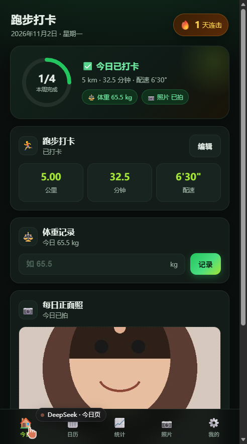
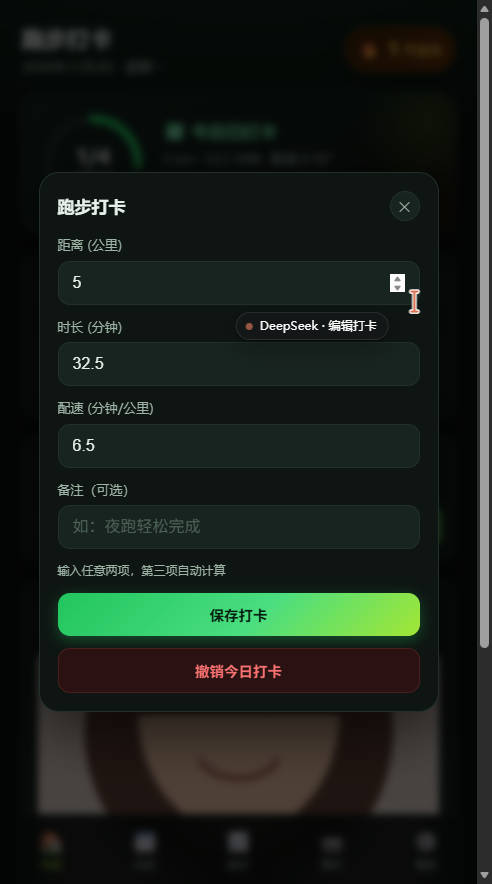
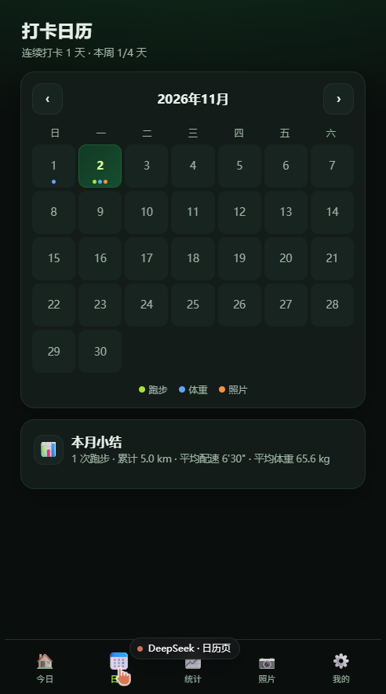
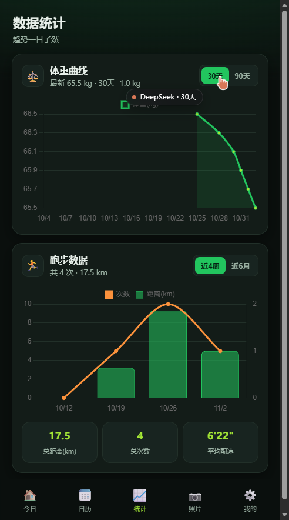
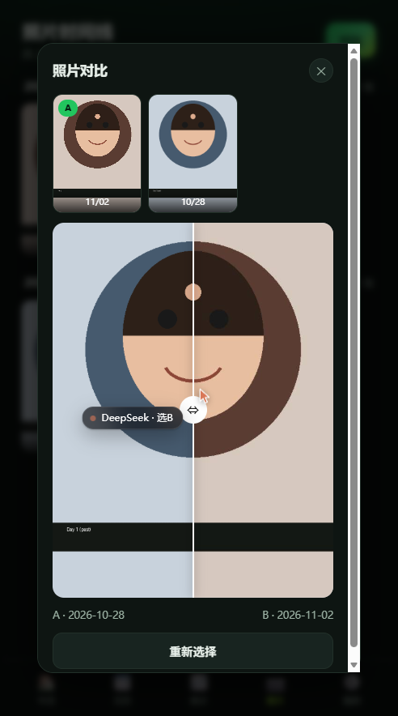
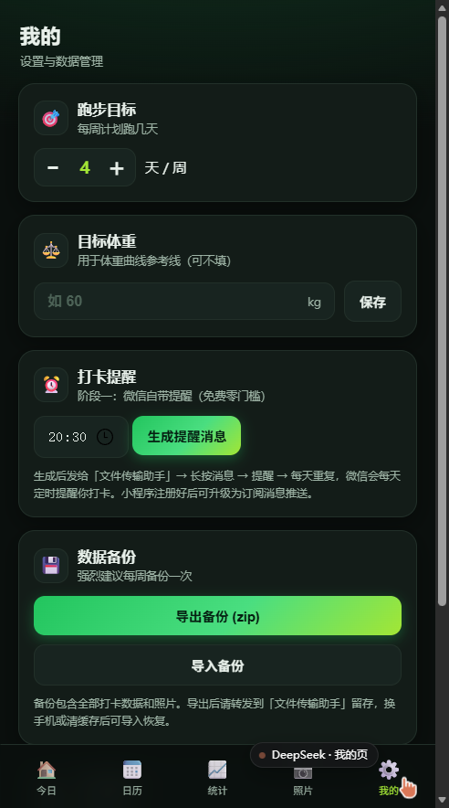
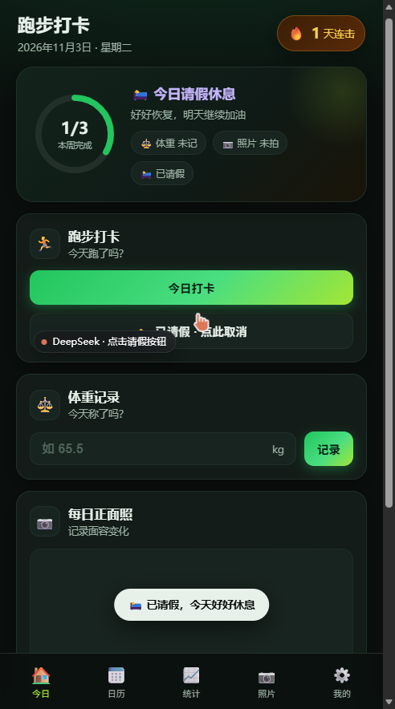
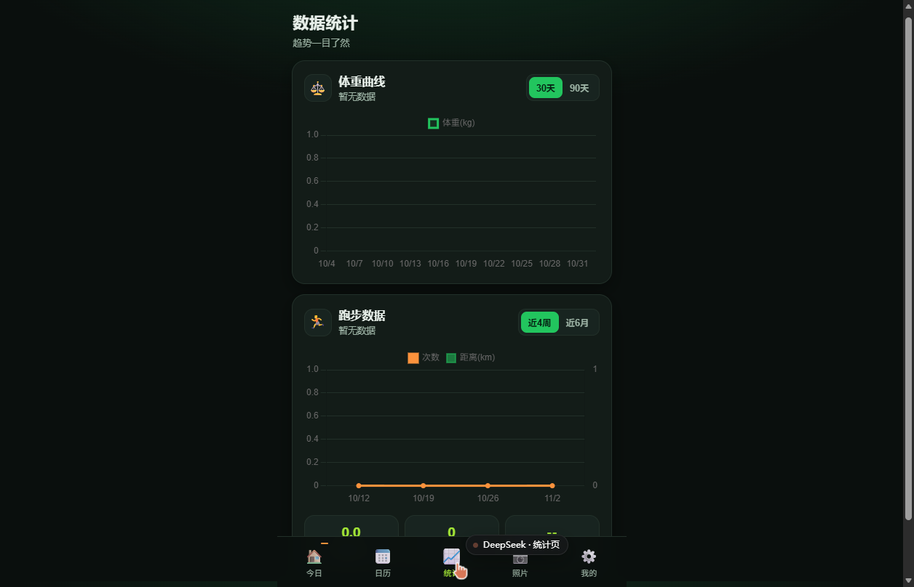

# 🏃 跑步打卡

多用户跑步打卡系统：**每日跑步打卡 + 体重记录 + 面容照片变化追踪**，微信内使用。

[](LICENSE)

> 🆕 **v2.1.0 多用户版**：每人注册自己的账号，数据云端保存、互相不可见。详情见 [多用户架构说明](docs/多用户架构说明.md)，安装包见 [Releases](https://github.com/Alwayso08/run-checkin/releases/latest)。

## 项目组成

| 目录 | 说明 |
|---|---|
| `h5/` | 打卡网页（前端 + Pages Functions 后端，托管在 Cloudflare Pages：https://run-checkin.pages.dev） |
| `h5/functions/api/` | 后端 API（注册/登录/记录/照片，Cloudflare Pages Functions + D1） |
| `miniprogram/` | 微信小程序（每日打卡提醒壳，基于云开发订阅消息） |
| `docs/` | 设计文档与部署教程 |

## 功能

- 今日打卡：距离 / 时长 / 配速（任意两项自动算第三项）、备注、可编辑撤销
- 每周目标监督：自定义每周跑几天、周进度环、连击天数、请假/休息日（目标自动顺延）
- 体重记录：每日体重 + 30/90 天曲线 + 目标体重参考线
- 面容照片：每日正面照（自动压缩），按月时间线 + 双图滑动对比
- 数据统计：近 4 周/近 6 月跑步图表、平均配速
- 数据导出：完整备份 zip（含照片）、Excel/CSV 表格
- 打卡提醒：微信自带提醒（当前）/ 小程序订阅消息（可选）

## 技术栈

- 网页：纯 HTML/CSS/JS + Chart.js + JSZip
- 后端：Cloudflare Pages Functions（API）+ D1 数据库（多用户、密码 PBKDF2 哈希、会话 Cookie）
- 小程序：原生小程序 + 云函数（定时订阅消息）
- 托管：Cloudflare Pages（免费额度内）

## 数据说明（多用户版）

- 每个用户注册独立账号，数据按账号隔离存储在 Cloudflare D1，**互相不可见**
- 密码仅存 PBKDF2 哈希，登录会话 30 天有效
- 仍建议定期使用「我的 → 导出备份」下载 zip 备份
- 详细架构、接口与免费额度见 [多用户架构说明](docs/多用户架构说明.md)

## 界面预览

| 今日页 | 打卡弹窗 | 日历 |
|---|---|---|
|  |  |  |

| 统计 | 照片时间线 | 双图对比 |
|---|---|---|
|  |  |  |

| 我的 | 请假休息 | 首次打开 |
|---|---|---|
|  |  |  |

## 更新网站（自动化）

网站托管在 Cloudflare Pages：**https://run-checkin.pages.dev**。更新代码后重新部署即可，四种方式任选：

### 方式一：AI 助手一键更新（推荐，零操作）

把改动需求告诉助手，它会自动：改代码 → 本地测试 → 一键部署上线，全程无需你动手。

### 方式二：GitHub Actions 自动部署（已启用 ✅）

工作流 [`.github/workflows/deploy.yml`](.github/workflows/deploy.yml) 已内置并**验证可用**：任何推送到 main 且涉及 `h5/` 目录的提交，都会自动部署到 Cloudflare Pages。

- 所需的两个 Secrets（`CLOUDFLARE_API_TOKEN`、`CLOUDFLARE_ACCOUNT_ID`）已配置在仓库 Actions Secrets 中
- 也可以在 **Actions → Deploy H5 to Cloudflare Pages → Run workflow** 手动触发
- 修改 h5/ 文件并提交后，约 1 分钟自动上线

> 提示：如果更换了 Cloudflare 令牌，记得到 Settings → Secrets 更新 `CLOUDFLARE_API_TOKEN`。

### 方式三：本地命令部署

```powershell
npm install -g wrangler        # 仅首次
$env:CLOUDFLARE_API_TOKEN = '<你的 Cloudflare 令牌>'
wrangler pages deploy h5 --project-name=run-checkin
```

### 方式四：Cloudflare 网页上传

Cloudflare 后台 → **Workers 和 Pages** → run-checkin → **创建新部署 → 直接上传** → 拖入 `h5/` 目录里的文件 → 部署。

> 💡 更新代码**不会影响**账号里的打卡数据（数据存在云端数据库，与网址和本机存储无关）。

## 文档

- [多用户架构说明](docs/多用户架构说明.md)
- [设计方案](docs/跑步打卡H5设计方案.md)
- [部署到微信手把手教程](docs/部署到微信·手把手教程.md)
- [小程序部署指南](docs/小程序部署指南.md)

## License

本项目采用 **GNU General Public License v3.0（GPL-3.0）** 开源，完整条款见 [LICENSE](LICENSE)。

| | 说明 |
|---|---|
| ✅ 允许 | 自由使用、修改、分发（个人或商业用途均可） |
| ✅ 要求 | 分发修改版时必须同样以 GPL-3.0 开源，并提供完整源代码 |
| ❌ 禁止 | **将本代码用于闭源商业项目**：分发基于本项目的衍生作品必须公开全部源码 |
| ⚠️ 例外 | 如需闭源商业使用，须获得作者单独授权（双许可），请通过 Issue 联系 |

> 简单说：**可以拿去用、可以改、可以卖，但不能偷偷闭源。** 闭源商用请先联系作者授权。
